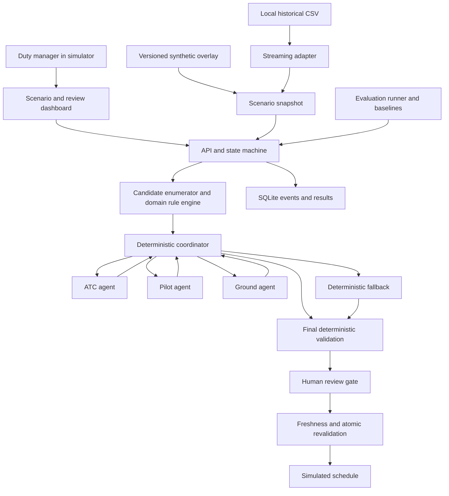

# PLAB.ai technical product requirements

**Status:** Proposed implementation specification; no application or agent benchmark results are claimed.

**Prepared:** 31 October 2026, Asia/Singapore.

**Team and delivery constraint:** Three collaborators, including the project owner; four hours of implementation time.

**Product:** A supervised airport disruption coordination simulator for Challenge #2.

## 1. Product decision

Build a working decision-support prototype that helps an **airport operations duty manager coordinate one disrupted arrival** with independently represented ATC, pilot/airline, and ground operations interests. Given a qualifying historical flight record and an explicitly simulated operational snapshot, the system proposes a revised arrival slot, taxi route, and gate allocation; three agents negotiate a common plan; deterministic rules verify it; a human reviews the evidence and decides whether to apply it to the simulator.

The central product claim is deliberately testable: **three independently invoked domain agents can exchange structured concessions and reach a checkable recommendation within two negotiation rounds, or terminate with an honest fallback or escalation.** A qualified person's authority remains separate from agent agreement.

The four-hour build must demonstrate this complete chain:

```text
Qualifying historical row + declared simulation inputs
  → validated, versioned snapshot
  → bounded candidate enumeration and deterministic domain checks
  → ATC / Pilot / Ground proposals
  → deterministic reconciliation
  → ATC / Pilot / Ground votes on exactly one plan
  → consensus OR deterministic fallback OR escalation
  → human review and fresh validation
  → simulated application OR rejection
  → trace and evaluation evidence
```

The system is a simulator and decision-support experiment. It does not issue operational clearances, control aircraft, contact real airport staff, or establish compliance with aviation regulations. This boundary determines the data, authority model, UI labels, and claims the team can demonstrate.

### 1.1 Delivery priorities

1. An end-to-end vertical slice, including a real model call for each of the three roles.
2. Deterministic constraint checks, bounded negotiation, and deterministic fallback.
3. Human approval enforced by the backend, with rejection and stale-plan handling.
4. Reproducible evaluations against fair baselines, with a visible failure case.
5. A clear interface and a rehearsed presentation shorter than three minutes.

Items 2–4 are core functionality. They must survive scope cuts.

### 1.2 Document map

- Sections 2–5: source interpretation, problem, scope, and verified data.
- Sections 6–10: requirements, architecture, constraints, protocol, and contracts.
- Sections 11–13: human oversight, interface, persistence, APIs, and reliability.
- Sections 14–16: evaluations, acceptance gates, and judging evidence.
- Sections 17–19: four-hour ownership plan, risks, and future expansion.
- Appendices: reproducible scenario example, traceability, and references.

## 2. Source interpretation and judging strategy

### 2.1 Repository material reviewed

All three Markdown files present before this PRD were read in full:

| Source | What it establishes | Consequence |
|---|---|---|
| [README](../README.md) | Large local data files are excluded from Git | Provide local extraction and small scenario manifests; do not require committing the full CSV |
| [Problem statement](problem_statement.md) | Three independent domains, structured communication, explicit constraints, traceable consensus, deterministic fallback, a qualifying delay row, and resolution in under three turns | These are mandatory acceptance requirements |
| [Judging rubrics](judging_rubrics.md) | Problem realism, technical soundness, honest evaluation, trust, impact, and time discipline | Produce evidence for each criterion, not just a success animation |

The rubric contains duplicated summaries and an earlier five-criterion presentation. This PRD uses its explicit **six-criterion weighted table** as the planning interpretation. Confirm with an organizer if a newer official rubric is supplied; do not treat duplicated text as additional criteria.

The source material describes communication fragmentation and operational consequences. The deeper causal explanations in Section 3 are design hypotheses to test, not findings from interviews or a separate operational study.

### 2.2 Weighted judging requirements

| Criterion | Weight | Evidence the product must make visible | Four-hour priority |
|---|---:|---|---|
| Problem realism | 20% | Named duty-manager workflow; disruption trigger; conflicting domain responsibilities; current coordination burden | One concrete scenario and clear scope |
| Technical soundness | 25% | Three separate agent invocations; structured messages; executable checks; two-round bound; working fallback | End-to-end live path plus fault tests |
| Honest evaluation | 20% | Frozen scenarios; baseline comparisons; actual counts; at least one failure or refusal; synthetic-data disclosure | Evaluation runner and report start alongside implementation |
| Trust and traceability | 20% | Fact/rule references, uncertainty, same-plan votes, human approval, stale-state rejection | Evidence panel and backend approval gate |
| Impact | 10% | Paired simulated outcomes and coordination latency; explicit assumptions | Report measured replay differences, including regressions |
| Time discipline | 5% | Valid submission timestamp; focused presentation below 180 seconds | Reserve the final 30 minutes for evidence, submission, and rehearsal |

Weighted score is `sum((criterion_score / 5) × criterion_weight)`. Evaluation and trust contribute 40%; adding technical soundness brings the share to 65%. The team should allocate engineering time accordingly. This is a prioritization argument, not a predicted judging score.

### 2.3 Resolve two ambiguous requirements

**Autonomy versus human control.** The agents negotiate without intervention between initiation and a terminal recommendation. Consensus does not authorize execution. A human subsequently approves or rejects simulated application. Missing essential information before negotiation, or terminal failure after it, is escalated visibly.

**Under three turns.** Implement at most **two parallel coordination rounds**, with three independent role generations per round, and at most six model generation requests in total. Show both `round_count` and `model_call_count`. The brief does not define a turn; six individual messages are not literally fewer than three messages. This interpretation should be stated in the submission and checked with an organizer when possible. No third round, hidden repair prompt, or automatic restart may be presented as part of the same successful run.

## 3. Problem analysis

### 3.1 Primary user and job

**Primary user:** An airport operations duty manager acting as the coordination lead in the demonstration.

**Job:** When an inbound flight is disrupted, assemble a mutually workable arrival and gate plan, understand the trade-offs, verify the relevant constraints, and obtain the appropriate operational decisions.

**Represented stakeholders:**

| Stakeholder | Information and responsibility | Consequence of a locally attractive but incompatible decision |
|---|---|---|
| ATC representative | Runway availability, movement spacing, taxi-route access, capacity | An early arrival may conflict with another movement or a blocked taxi route |
| Pilot/airline representative | Supplied fuel envelope, permitted arrival conditions, passenger connections | Waiting for a preferred gate may consume the available reserve margin or worsen connections |
| Ground operations lead | Gate compatibility and occupancy, crew/equipment availability, turnaround | An acceptable landing time may leave no compatible gate or handling resources |
| Coordination lead | Shared picture, exception handling, accountable review | An agreement can become stale before anyone acts on it |

The prototype's one reviewer represents a demonstration role. It does not imply that a duty manager can replace ATC, pilot-in-command, airline, or ground-handler authority in an operational deployment.

### 3.2 Current process and limits of the evidence

The challenge describes disruptions coordinated through phone calls and manual software updates, with cascading delays, excessive holding, and fuel consumption. A plausible workflow is: detect disruption; contact each domain; collect constraints; compare options; resolve conflicts; update systems; recheck changed conditions. Its actual timing and frequency have not been measured in this repository.

Airport collaborative decision-making already emphasizes accurate and timely information sharing among airport partners. PLAB.ai therefore explores a bounded negotiation and evidence layer within that general problem; it should not claim to invent collaborative airport decision-making. [EUROCONTROL A-CDM](https://www.eurocontrol.int/concept/airport-collaborative-decision-making)

### 3.3 Root-cause hypotheses and product responses

| Hypothesis | Failure mechanism | Product response | Evidence needed to validate the hypothesis |
|---|---|---|---|
| Fragmented operational information | Participants make decisions using different snapshots | Immutable scenario revision, shared candidate IDs, explicit freshness | Practitioner workflow observation and real update histories |
| Conflicting local objectives | Each domain's preferred plan burdens another | Independent role preferences, structured concessions, common proposal | Demonstrate a scenario with genuinely different first choices |
| Serial cross-domain checks | A late constraint discovery invalidates earlier coordination | Parallel domain assessment and deterministic checks before commitment | Measure machine latency; future user study for coordination time |
| Ambiguous or unrecorded agreement | People agree to different times, gates, or conditions | Votes bound to a complete plan hash and rule revision | Crossed-version fault tests and readable consensus trace |
| Unclear exception ownership | Disagreement or missing information produces repeated exchanges | Two-round bound, typed failure reasons, deterministic fallback, escalation | Timeout, dissent, missing-data, and infeasibility tests |
| Conditions change after agreement | A once-valid plan is applied to an obsolete situation | Resource revision checks, expiry, atomic approval-time revalidation | Stale-gate and competing-approval tests |

The CSV does not identify these communication mechanisms. Delay attribution alone cannot establish their prevalence or prove that automating coordination would remove a specific historical delay.

### 3.4 Why use multiple agents

The challenge requires independently represented domains. Multiple agents are useful here when each can preserve its own policy, expose a conflict, offer a bounded concession, and explicitly accept or reject a common plan. A single prompt impersonating three roles cannot demonstrate that coordination.

The agents are **not the numerical optimizer or safety authority**. They interpret role context, select among already evaluated alternatives, communicate preferences, and explain concessions. Deterministic code owns arithmetic, feasibility, selection policy, state transitions, and application. The evaluation must test whether the additional agent layer improves preference handling or reviewability enough to justify its latency and cost. A deterministic optimizer may match or outperform it on numerical objectives.

## 4. Product scope

### 4.1 Mandatory four-hour slice

- One airport scenario at a time, centered on one qualifying disrupted inbound flight.
- One runway, two gates, up to two predefined taxi-route alternatives per gate, and a small fixed background schedule.
- A 30-minute search window after the earliest simulated landing time, on one-minute increments: at most `31 × 2 × 2 = 124` raw candidate combinations.
- Background movements and gate reservations are fixed inputs. The MVP does not jointly reschedule all traffic.
- Revised landing time, gate-in time, gate assignment, taxi-route selection, and derived handling completion.
- Three independently invoked domain agents, two rounds, a deterministic coordinator, and visible message records.
- Versioned illustrative runway, taxi, fuel, gate, crew, and route-permission checks.
- Deterministic feasible fallback, or non-executable escalation if no validated plan is available.
- Human approval, rejection, and input revision followed by a separately identified run.
- Paired replay baselines, a small frozen evaluation suite, fault tests, and downloadable evidence.

Sector throughput is represented only by checking a fixed movement schedule and counting modeled movements inside a configured window. Turbulence is represented only by supplied permitted/blocked arrival-option labels. Crew overtime and connection impacts use explicit synthetic inputs. These limited representations must remain visible; they do not constitute sector-wide optimization, weather prediction, or operational flight planning.

### 4.2 Scope levels

| Priority | Included capability | Scope rule |
|---|---|---|
| P0 | Full path from row selection to approved simulator update | Required |
| P0 | All domain hard checks, two-round bound, fallback, evidence | Required even if UI is basic |
| P0 | Approve/reject; edited inputs create a new run | No freeform direct plan editing needed |
| P0 | Baselines, measured report, visible failure | Never replace with invented metrics |
| P1 | Better candidate comparison charts and trace filtering | Only after P0 integration passes |
| P1 | Additional airports, richer connection groups, repeated evaluation runs | Add only within remaining time and budget |
| P2 | Multi-flight scheduling, multiple runways, detailed routes, live feeds | Future work |
| P2 | Enterprise identity, cross-organization approvals, certified rule packs | Future work |

### 4.3 Explicit exclusions

No live flight tracking integration, weather ingestion, real gate/crew systems, voice communications, real clearance issuance, emergency procedure advice, automatic diversion, 3D airport map, general aviation chatbot, RAG knowledge base, training pipeline, vector database, or autonomous real-world execution is needed for the MVP. Full trajectory or airspace-sector optimization is outside this build. The challenge allows revised arrival or gate assignment, so these exclusions do not remove the central demonstration.

## 5. Data requirements and observed repository profile

### 5.1 Verified local profile

A streaming CSV inspection on 31 October 2026 found:

| Property | Observed count or value |
|---|---:|
| `data/flights.csv` size | 592,406,591 bytes |
| Flight records, excluding header | 5,819,079 |
| Columns | 31 |
| Recorded year | 2015 for every record |
| `WEATHER_DELAY > 15 OR LATE_AIRCRAFT_DELAY > 20` | 376,125 records |
| Weather criterion only | 33,607 |
| Late-aircraft criterion only | 332,647 |
| Both criteria | 9,871 |
| Blank entries in each of the two cause columns | 4,755,640 |
| Cancelled records | 89,884 |
| Diverted records | 15,187 |
| Airline lookup rows | 14 |
| Airport lookup rows | 322 |
| Flight rows with numeric airport IDs absent from the supplied IATA lookup | 486,165, all in October |
| Challenge-eligible rows affected by that identifier mismatch | 17,351 |

These are dataset inspection results, **not agent evaluation results**. All 376,125 eligible rows are noncancelled and nondiverted; 358,774 also resolve both airports and the airline against the supplied lookups, before further completeness/scope filters. The inspected flight file has SHA-256 `afa4e42188b113dd69427a3fbd00a4b6979c6235c866f963c2899d18a3403a83`. Regenerate counts when the input file changes and persist its hash in the profile artifact. Appendix D supplies a reproducible streaming command.

### 5.2 Useful seeds

| Locator | Flight | Historical qualifying values | Historical reference outcome |
|---|---|---|---|
| `flights.csv`, one-based data record 71; physical CSV line 72 | AA1057, DFW → MIA, 2015-01-01 | Weather 102 min; late aircraft 0 min | Arrival delay 102 min |
| `flights.csv`, one-based data record 399; physical CSV line 400 | B61434, SJU → MCO, 2015-01-01 | Weather 0 min; late aircraft 88 min | Arrival delay 88 min |
| `flights.csv`, one-based data record 9251; physical CSV line 9252 | MQ3582, DFW → LAW, 2015-01-01 | Weather 20 min; late aircraft 53 min | Arrival delay 78 min |

Record ordinal is the canonical locator; physical lines are only convenient references for the supplied file. Store the file hash, original row, natural flight identity, and extraction version locally with each run. Do not assume a flight number alone uniquely identifies a flight.

### 5.3 Field mapping

| CSV fields | Use | Restrictions |
|---|---|---|
| `YEAR`, `MONTH`, `DAY`, `AIRLINE`, `FLIGHT_NUMBER`, `TAIL_NUMBER`, airports | Source identity and descriptive context | Lookup failure is explicit; no invented airport identity |
| `WEATHER_DELAY`, `LATE_AIRCRAFT_DELAY` | Challenge eligibility and retrospective scenario trigger | Not a live forecast, closure duration, or holding duration |
| Scheduled time fields | Historical reference context | HHMM parsing requires rollover handling; timezone is absent |
| `ARRIVAL_TIME`, `ARRIVAL_DELAY`, actual elapsed/air/taxi times | Outcome reference and data exploration | Excluded from operational decision facts and benefit calculation |
| `CANCELLED`, `DIVERTED` | Cohort filtering | Exclude from normal-arrival MVP and report counts |
| Other delay causes | Descriptive historical evidence | Missing remains missing; no causal reconstruction without additional evidence |

BTS defines late-arriving-aircraft delay as propagation from a preceding flight and distinguishes several broad delay categories. Weather impact is not confined to one weather column. These definitions inform cautious interpretation; the repository does not contain a provenance document proving a particular distribution or its reuse license. [BTS delay definitions](https://www.bts.gov/topics/airlines-and-airports/understanding-reporting-causes-flight-delays-and-cancellations)

### 5.4 Ingestion requirements

**DATA-01:** Stream the large CSV once to build a small eligible index; do not send it to an LLM or load it into the browser. Cache by file hash and parser version. A full index is optional in the four-hour build; extracting declared seed rows and a small reproducible sample is sufficient.

**DATA-02:** Preserve original strings and nulls. Evaluate eligibility as `(weather is present and weather > 15) OR (late is present and late > 20)`. Missing is not a factual zero. Exactly 15 and exactly 20 do not qualify through those respective branches.

**DATA-03:** For the MVP, exclude unresolved airport identifiers and report that exclusion. Do not guess a numeric-to-IATA mapping. A verified crosswalk is future work.

**DATA-04:** Exclude cancelled/diverted flights from ordinary arrival scheduling. Preserve exclusion reasons and cohort counts. Select holdout rows from distinct dates/flight identities and more than the first January block where feasible.

**DATA-05:** Keep historical HHMM strings in the provenance record. `2400`, overnight events, and timezone ambiguity require explicit treatment if converted. The simulator uses a supplied UTC epoch and relative integer seconds, avoiding an invented historical timezone conversion.

**DATA-06:** Pass the same allowlisted selected-row parameters to all three agents: source identity, qualifying delay causes, cancellation/diversion status, and any explicitly permitted scheduled reference context. Label this block historical and retrospective. Preserve the complete original row in local provenance and the reviewer source panel, but omit actual arrival, arrival delay, actual elapsed/air/taxi times, and other outcome-only fields from all generation prompts and agent-accessible tool results. Backend operational calculations use only the declared decision snapshot. Providing source parameters does not require exposing every outcome column to the agents.

**DATA-07:** Do not redistribute the large raw data. Commit synthetic overlays and source-row locators; extract historical rows locally. Confirm dataset redistribution rights before publishing raw-row bundles. The existing repository license alone does not establish the CSVs' license.

### 5.5 Required simulated operational overlay

Every scenario supplies the fields missing from the historical files:

- Decision epoch, earliest landing time, search horizon, snapshot revision, and freshness policy.
- Fixed background movements, runway occupancy intervals, illustrative wake categories and separation table, and capacity window.
- Permitted taxi routes, traversal durations and edge intervals, blockage windows, and gate connectivity.
- Gate compatibility, occupancy/release times, buffer, service duration, and handling resources.
- Projected fuel at earliest landing, holding/taxi burn assumptions, reserve floor, and uncertainty allowance.
- Predeclared arrival-option weather/turbulence permission; no inference from a delay number.
- Crew availability, regular shift end, maximum scenario duty end, equipment availability, and task duration.
- Optional synthetic connection groups, transfer times, and deadlines; omit the metric if absent.
- Domain preference policy and explicitly bounded concession permissions.

Use provenance classes `historical_observed`, `synthetic_scenario`, `policy`, and `derived`. A derived fact records upstream fact IDs and calculation version. A policy fact records its owner, units, revision, applicability, and whether it is illustrative. No required fuel, route, wake, gate, or crew fact may be supplied by an agent's guess.

## 6. Functional requirements

| ID | Requirement | Acceptance evidence |
|---|---|---|
| FR-01 | Select a qualifying historical source record and show the eligibility calculation | Boundary fixtures and source panel |
| FR-02 | Build and freeze a typed operational snapshot with per-field provenance | Snapshot JSON and hash |
| FR-03 | Generate a bounded catalog of candidate landing/gate/route plans | Enumeration count and deterministic ordering |
| FR-04 | Evaluate required ATC, pilot, and ground rules with `PASS/FAIL/UNKNOWN` | Rule-level results, numeric margins, input references |
| FR-05 | Invoke three separate role agents with separate prompts and message identities | Actual provider request records, not three UI labels |
| FR-06 | Exchange structured offers and votes through a deterministic coordinator | Schema-valid messages and reconciliation event |
| FR-07 | Finish negotiation in at most two rounds and six generation requests | Counter assertions across success and fault cases |
| FR-08 | Declare consensus only when three current votes accept the same checked plan | Crossed-hash, dissent, and missing-vote tests |
| FR-09 | Use non-AI fallback on negotiation failure; escalate when no checked option exists | Model-offline, no-plan, and missing-data cases |
| FR-10 | Explain the recommendation, rejected alternatives, concessions, and evidence | Human inspection of trace and claim references |
| FR-11 | Require backend approval before any simulator change | Unapproved and unauthorized apply tests |
| FR-12 | Support reject and revise-and-rerun with preserved prior history | Old votes cannot authorize the revised run |
| FR-13 | Revalidate resource revision, rule version, plan hash, and expiry at approval | Stale-plan and double-submit tests |
| FR-14 | Run baselines and full-system evaluations on identical scenario snapshots | Versioned manifest and paired results |
| FR-15 | Export readable and machine-readable evidence with failures retained | JSON trace, results table, report |
| FR-16 | Clearly distinguish live execution, recorded replay, model stub, and deterministic fallback | Persistent mode label in UI and exports |

### 6.1 Nonfunctional requirements

- **Boundedness:** Maximum 124 raw candidate combinations under the default scope; two rounds; six generation requests; no recursive delegation.
- **Latency:** Proposed target below 30 seconds from accepted input to terminal recommendation on the demonstration machine; hard run deadline 45 seconds. Human review time is separate. These are targets pending measurement.
- **Request limits:** Initial per-agent timeout 12 seconds, maximum output 500 tokens, no automatic SDK or application model retry. Tune only with recorded evidence and stay within the run deadline.
- **Reproducibility:** Deterministic scenario generation, candidate order, checks, selection, and fallback for the same versioned inputs. Live LLM responses are not promised to be deterministic.
- **Durability:** Persist terminal plans, votes, decisions, and events to SQLite before acknowledging them. A restart must not accidentally apply or approve an unfinished run.
- **Usability:** Important states are readable without interpreting raw JSON; details remain accessible.
- **Security:** API credentials stay server-side. Model content is untrusted. Approval authority comes from the authenticated/local trusted session, never from model output.
- **Cost:** Record provider usage and attempted requests, including failures. Set a team budget during setup; stop optional repeated evaluations before exceeding it. No unverified dollar estimate belongs in the report.
- **Deployment:** One local service and same-origin browser interface are sufficient. Public hosting is optional and must not consume the final integration window.

## 7. Technical architecture

### 7.1 Four-hour stack decision

Use **Python, FastAPI, Pydantic, SQLite, and a small same-origin HTML/CSS/JavaScript dashboard**, with one model-provider adapter. Use `asyncio` to run the three role calls concurrently. Poll persisted run state approximately once per second; streaming infrastructure is unnecessary for this scope.

This is a proposed stack, not an inventory of existing application code. At the time of analysis the repository contains source documents and CSVs, with no application scaffold. Pin the actual dependency versions in a lockfile at implementation time. Use an available provider/model whose structured-response behavior is smoke-tested during the first 15 minutes; model name, version, settings, and prompt hashes must be recorded.

A plain deterministic state machine is the default. LangGraph is optional only if a collaborator already has a working starter. Its interrupt mechanism supports persisted pauses and resumes, but introducing an unfamiliar orchestration framework is unnecessary here. If used, resumed nodes can repeat pre-interrupt code, so approval side effects must remain idempotent. [LangGraph interrupts](https://docs.langchain.com/oss/python/langgraph/interrupts)

### 7.2 Components and trust boundaries



The coordinator and checker sit outside the LLM trust boundary. Agents can propose and vote; they cannot modify the scenario, change a hard rule, write the schedule, impersonate the reviewer, or change turn counters.

### 7.3 Domain independence

| Role | Own context and deterministic service | Permitted reasoning | Cannot do |
|---|---|---|---|
| ATC | Movement schedule, runway/route status, separation/capacity reports | Prefer lower delay and preserve modeled capacity; explain sequencing concessions | Waive separation or reopen blocked resources |
| Pilot | Fuel envelope, permitted arrival options, connection groups | Prefer less modeled fuel use and fewer missed connections; offer delay concessions | Invent reserves, alter burn assumptions, or prescribe emergency actions |
| Ground | Gate/crew/equipment schedule, handling reports | Prefer compatible gates, less overtime, lower turnaround delay | Invent a free gate or bypass duty/equipment limits |

The three roles may share one model, process, and codebase. Independence requires separate model calls, role prompts, scoped context, outputs, and trace identities. Cross-domain information reaches them as structured messages and selected evidence summaries, not shared mutable prompt state.

For the MVP, domain tools are deterministic functions evaluated before model calls. Their structured results are injected into each role's context. The model need not invoke a tool recursively to demonstrate tool-assisted reasoning; this design keeps call budgets enforceable.

### 7.4 Proposed implementation layout

```text
app/
  main.py                 API and static UI serving
  contracts.py            Pydantic schemas shared by all modules
  data_adapter.py         Local row extraction and provenance
  scenarios.py            Overlay loading and snapshot validation
  planning.py             Candidate generation, scoring, baselines
  constraints.py          ATC, pilot, ground checks
  agents.py               Three role wrappers and provider adapter
  coordinator.py          Bounded negotiation state machine
  approvals.py            Authorization, revalidation, application
  store.py                SQLite transactions and events
  static/                 HTML, CSS, JavaScript dashboard
scenarios/                Synthetic manifests and source locators
policies/                 Illustrative rules and objective policies
evals/                    Frozen manifest, runner, expected outcomes
tests/                    Boundary, protocol, and approval checks
artifacts/                Generated local traces and measured reports
```

Generated raw traces may contain historical rows or provider metadata. Keep them local/ignored by default; publish a reviewed evidence export. This layout is a contract for the build, not a claim that the files already exist.

## 8. Deterministic planning and constraint model

### 8.1 Candidate definition

One candidate specifies the entire focal-flight plan:

```text
candidate_id, scenario_revision, resource_revision, ruleset_version
landing_time_s, runway_id, runway_occupancy_end_s
taxi_route_id, route_edge_intervals, gate_id, gate_in_time_s
service_start_s, service_end_s, gate_release_s, crew_id
arrival_option_id, derived impacts, evidence references
```

All `_s` values are integer seconds relative to the scenario's supplied UTC epoch. Internal operations never subtract raw HHMM values. The UI distinguishes landing, gate-in, and handling-complete times. Intervals use `[start, end)`: an interval ending exactly when another begins does not overlap unless a separate buffer rule requires a gap.

Candidate IDs and hashes are computed from canonical typed data. The plan hash covers the resource choices, timestamps, snapshot/resource revisions, and rule/policy versions; it excludes explanatory prose. Any material edit creates a different hash.

### 8.2 Generation procedure

1. Validate required facts and their units/applicability. Missing critical facts stop generation with `INSUFFICIENT_DATA`.
2. Generate landing slots from `earliest_landing_s` through `earliest_landing_s + 1800`, inclusive, every 60 seconds.
3. Combine each slot with up to two gates and up to two configured routes for that gate. Routes are predeclared; the model cannot invent a route.
4. Derive route-edge traversal, gate arrival, service, release, fuel, and impact values using deterministic functions.
5. Evaluate every applicable hard rule, retaining invalid candidates and reasons in the diagnostic record.
6. Keep only candidates with all required checks `PASS` for recommendation and agent consideration.
7. Build a shortlist of at most six distinct candidates: the best for each role, the best joint score, the procedural baseline candidate, then the next joint-score candidate if space remains. Deduplicate and use stable ordering. Agents receive the shortlist and the size of the full feasible catalog.

The shortlist is a communication limit. Fallback and deterministic baselines search the full catalog. Failure to find consensus on the shortlist does not imply no feasible plan exists.

### 8.3 Rule contract

Each result contains `rule_id`, `rule_version`, `domain`, `candidate_id`, `status`, `actual`, `operator`, `required`, `units`, `margin`, `evidence_ids`, and `reason_code`. Values can be intervals or typed structures where a single scalar is inappropriate. `margin` is only provided where its meaning is defined.

Statuses are:

- `PASS`: all required evidence is present and the configured rule holds.
- `FAIL`: evidence is present and the rule is violated.
- `UNKNOWN`: required evidence, applicability, or valid computation is missing.

Required `FAIL` or `UNKNOWN` prevents an approval-ready result. An LLM's agreement cannot convert either into `PASS`.

### 8.4 Hard constraints

| Rule | Deterministic test | Required evidence |
|---|---|---|
| ATC-RWY-01 | Focal runway occupancy must be wholly inside an available interval and not overlap a fixed occupancy | Availability/occupancy intervals and focal occupancy duration |
| ATC-SEP-01 | For every relevant preceding/following movement, modeled spacing meets the applicable ordered wake-category requirement | Movement times, wake categories, applicable scenario separation table |
| ATC-TAXI-01 | Every timed route edge is available during traversal; route ends at assigned gate | Route graph/edge timings and blockage intervals |
| ATC-CAP-01 | Adding the focal movement does not exceed the configured movement count in any applicable capacity window | Fixed movement schedule, window definition, limit |
| PILOT-FUEL-01 | Conservative modeled fuel at gate is at least reserve floor plus uncertainty allowance | Fuel projection, burn rates, hold/taxi durations, threshold |
| PILOT-ROUTE-01 | Chosen arrival option is explicitly permitted by the scenario's weather/route restrictions | Versioned permission labels; unknown is not permitted |
| GROUND-GATE-01 | Gate supports the supplied aircraft compatibility class | Aircraft class and gate compatibility set |
| GROUND-OCC-01 | Focal gate interval, including configured buffer, does not overlap another reservation | Gate-in, release, buffer, existing reservations |
| GROUND-CREW-01 | Assigned crew is available for the task and completion is within the scenario's maximum duty end | Crew calendar, task interval, maximum duty end |
| GROUND-EQUIP-01 | All required handling equipment is available for the required service interval | Equipment requirements and calendars |
| SYSTEM-FRESH-01 | Required snapshot/resource/rule versions match and facts remain valid | Version IDs and validity metadata |

All aviation-like numeric thresholds in the MVP are **illustrative scenario policies**. They are not represented as FAA, ICAO, CAAS, airline, aircraft, or airport compliance minima. Production rules would require qualified review, applicability logic, and authoritative revision control.

For separation, check both the preceding and following fixed movement. For gate occupation, check the entire occupancy interval, not only the instant of arrival. For closures and blocked routes, check interval overlap, not just start time. These are explicit test boundaries.

### 8.5 Fuel and handling calculations

Let `e` be earliest landing, `l` proposed landing, `τ` taxi duration in seconds, `F_e` the scenario's projected fuel at earliest landing, `b_h` holding burn in kg/min, and `b_t` taxi burn in kg/min:

```text
additional_hold_min = (l - e) / 60
taxi_min = τ / 60
fuel_at_gate_kg = F_e - b_h × additional_hold_min - b_t × taxi_min
required_fuel_kg = reserve_floor_kg + uncertainty_allowance_kg
reserve_margin_kg = fuel_at_gate_kg - required_fuel_kg
```

Require `l >= e`, known units, and `reserve_margin_kg >= 0`. Validate all projected fuel, reserve floors, uncertainty allowances, burn rates, durations, and buffers as finite and nonnegative; require positive capacity-window lengths, ordered interval endpoints, and positive normalization denominators. Reject invalid policy configuration before planning. Use exact scaled integers or decimal arithmetic for threshold comparisons. `F_e` already includes the common pre-earliest-arrival journey; do not subtract that fuel twice. Historical delay minutes are not substituted for additional holding.

This is a deliberately simple fuel proxy, not a flight-performance or reserve-compliance model. If a required parameter is unknown, withhold approval-ready output. Do not describe an unsupported default hold as safe.

For ground handling:

```text
gate_in_s = landing_time_s + taxi_duration_s
service_start_s = gate_in_s + configured_pre_service_buffer_s
service_end_s = service_start_s + service_duration_s
gate_release_s = service_end_s + configured_release_buffer_s
crew_overtime_min = max(0, service_end_s
                          - max(service_start_s, regular_shift_end_s)) / 60
turnaround_lateness_min = max(0, service_end_s - target_service_end_s) / 60
```

This overtime measures the portion of this task performed after the regular shift ends; it does not charge idle time before service begins. Maximum duty end is a separate hard scenario limit. Overtime before that limit is a cost, not automatically a hard prohibition. No crew reassignment optimizer is required: use a declared compatible crew assignment per gate/route scenario.

A synthetic connection group is missed when `gate_in_s + transfer_time_s > connection_deadline_s`; sum the group passenger counts. This is a modeled deadline outcome, not a calibrated probability of missing a connection.

### 8.6 Objective policy

Hard constraints are filtered before optimization. No weighted benefit can compensate for a failed hard rule.

Use a versioned transparent policy. Suggested toy defaults for the first scenario are:

```text
additional_landing_delay_s = landing_time_s - earliest_landing_s
modeled_fuel_used_kg = F_e - fuel_at_gate_kg

J_ATC = additional_landing_delay_s / 1800
J_PILOT = 0.5 × modeled_fuel_used_kg / 800
          + 0.5 × missed_connection_passengers / 20
J_GROUND = 0.5 × crew_overtime_min / 20
           + 0.5 × turnaround_lateness_min / 30

joint_order = (
  max(J_ATC, J_PILOT, J_GROUND),
  J_ATC + J_PILOT + J_GROUND,
  landing_time_s,
  gate_in_time_s,
  gate_id,
  taxi_route_id,
  candidate_id
)
```

Here `modeled_fuel_used_kg` means modeled fuel consumed after the earliest-landing reference, including taxi fuel. It is not the fuel difference against B0; calculate that difference separately. The denominators and weights are illustrative preference normalization, not empirical valuations. Scores need not be clipped at one. Show raw seconds, kilograms, passengers, and minutes beside the score. If connection inputs are intentionally absent, use a distinct policy version that disables that term and declares the revised weights; do not replace unknown passengers with zero.

The coordinator minimizes this tuple within the mutually offered candidate set. The centralized baseline minimizes the same tuple across all feasible candidates. Role rankings and concession budgets are deterministic policy outputs that agents may discuss but cannot silently rewrite. An agent may decline a suggested concession; unanimity is never forced.

For role `r`, compute `best_r = min(J_r)` over the provided feasible shortlist. The default initial eligible set contains candidates tied at `best_r`; the concession envelope contains candidates with `J_r <= best_r + delta_r`. Set illustrative `delta_ATC = delta_PILOT = delta_GROUND = 0.25` for the worked fixture. Persist these values in the policy. The role can offer subsets of its allowed sets or decline to offer any; it cannot expand an envelope or alter a hard constraint. Its preferred ID must be in its offered initial set, and any supplied ranking must respect the deterministic cost ordering, with stable IDs breaking ties. An empty initial offer has `preferred_candidate_id=null` and is an explicit refusal, not a fabricated preferred candidate. Use exact rational or decimal comparisons for policy boundaries and ties. These envelopes permit the worked C2 compromise but do not guarantee the model will offer or accept it.

### 8.7 Deterministic fallback

Fallback makes zero LLM calls. Revalidate the full catalog and choose the first feasible candidate ordered by `(landing_time_s, gate_in_time_s, gate_id, taxi_route_id, candidate_id)`. This is also the procedural baseline policy. Persist a `fallback_reason`, blockers, and search bounds.

Possible outputs:

- `FEASIBLE_FALLBACK`: a model-valid plan, explicitly without agent consensus; human review required.
- `NO_FEASIBLE_OPTION_IN_SEARCH_SPACE`: all enumerated candidates fail at least one known rule; show horizon and option limits.
- `INSUFFICIENT_DATA`: required facts or applicability are unknown; request correction.
- `SYSTEM_ERROR`: computation or persistence is unreliable; no recommendation can be approved.

Fallback must not pick a least-unsafe candidate. A search failure does not prove that no real operational solution exists. Diversion, emergency handling, or further operational action belongs to the qualified human outside this simulator.

## 9. Multi-agent coordination protocol

### 9.1 Preparation

The server freezes the source row, scenario, resources, rules, objective policy, and candidate-set hashes. It validates required inputs and computes deterministic reports. Invalid input terminates before model calls. Every role receives the same run identity and historical seed, its scoped facts and reports, the shortlist, and the other domains' necessary published impact summaries.

### 9.2 Round 1 — offers and bounded concessions

All three role calls run concurrently. Each returns:

- Its preferred candidate and ranked candidate IDs from the shortlist.
- `acceptable_candidate_ids` under its initial preference.
- `concession_candidate_ids` it is willing to consider within the preconfigured soft-policy envelope.
- Objections with candidate, fact, and rule references.
- A short explanation of what it protects and what it could concede.

The backend validates candidate membership, structured numeric fields, reference IDs, and whether the offered concession obeys that role's policy. Numerical claims in the UI are rendered from cited deterministic results, not copied from freeform rationale. Ask agents to refer to evidence IDs rather than restating quantities; sample-review prose for unsupported assertions. Do not claim that schema checks semantically verify arbitrary text. The server supplies trusted role/run metadata itself. Hard violations should already be excluded from the shortlist; an agent flagging an inconsistent fact triggers deterministic revalidation rather than a vote to ignore it.

### 9.3 Reconciliation

Let `F` be the globally feasible shortlist and `A_r` and `C_r` be role `r`'s validated initial and concession sets:

```text
initial_intersection = F ∩ A_ATC ∩ A_PILOT ∩ A_GROUND
if initial_intersection is nonempty:
    proposed = argmin(joint_order, initial_intersection)
else:
    concession_intersection = F ∩ (A_ATC ∪ C_ATC)
                                ∩ (A_PILOT ∪ C_PILOT)
                                ∩ (A_GROUND ∪ C_GROUND)
    if concession_intersection is empty:
        terminate negotiation and run deterministic fallback
    proposed = argmin(joint_order, concession_intersection)
```

Reconciliation publishes the complete proposed plan, plan hash, each role's initial first choice, changes against that choice, constraint margins, and referenced objections. Even when initial offers agree, the final vote is required. A first-round offer is not a commitment to an unspecified final plan.

### 9.4 Round 2 — explicit commitment

Each role receives the same immutable proposal and structured summaries of all first-round offers. Each returns `ACCEPT`, `REJECT`, or `NEEDS_INFORMATION`, the exact plan hash, and evidence-backed rationale. This round demonstrates that a role responds to the other domains' trade-offs rather than independently issuing a final answer.

Consensus requires all of the following:

1. Exactly one current valid final vote from each of ATC, Pilot, and Ground.
2. All three votes are `ACCEPT`.
3. All votes refer to the identical run, scenario/resource revision, ruleset, policy, and plan hash.
4. The final plan passes the deterministic checker again.
5. The run has not expired, been cancelled, or exceeded either counter limit.

The coordinator records `FEASIBLE_CONSENSUS` and makes the plan available for human review. Any dissent, unknown, timeout, schema error, stale result, or missing vote terminates negotiation and invokes fallback/escalation. No majority voting is permitted for consensus.

### 9.5 Termination, retries, and recovery

- Maximum two negotiation rounds; maximum six generation requests. If failure is detected during Round 1, cancel pending calls where possible and use fallback; count every started request.
- Disable SDK retries. Invalid structured output is a protocol failure, not a prompt-repair opportunity.
- Deterministic JSON parsing/validation is allowed; speculative extraction from arbitrary prose is not.
- A late response is recorded as late and cannot overwrite a terminal result.
- Duplicate identical messages are idempotent. A conflicting duplicate during a nonterminal run causes protocol failure and fallback. After termination/application, append a diagnostic event without changing the prior outcome or applying another plan; any fresh review uses a new run.
- If resource, scenario, or rule/policy revision changes during negotiation, stop the current run as `INTERRUPTED` with reason `STATE_CHANGED`. Do not produce an approval-ready fallback from its obsolete catalog. A new snapshot requires a linked run with its own counters and visible history.
- A user cancellation stops negotiation and prevents later approval/application. A deliberate emergency stop does not wait for consensus.
- After a process restart, mark an interrupted model run `INTERRUPTED`; do not silently reissue calls. Offer a new linked run or deterministic recovery. A previously persisted pending plan may be reviewed only after freshness checks.
- A revised scenario or manual retry creates a new `run_id` with `parent_run_id`; display the chain. Restarting cannot hide failure or reset the original run's reported counters.

### 9.6 State and outcome model

Keep negotiation outcome separate from approval lifecycle:

```text
processing_state:
  CREATED → VALIDATING → PREPARING → ROUND_1 → RECONCILING
          → ROUND_2 → FINAL_VALIDATION → TERMINAL
  failure branches → FALLBACK → FINAL_VALIDATION → TERMINAL

negotiation_outcome:
  FEASIBLE_CONSENSUS | FEASIBLE_FALLBACK
  NO_FEASIBLE_OPTION_IN_SEARCH_SPACE | INSUFFICIENT_DATA
  SYSTEM_ERROR | CANCELLED | INTERRUPTED

approval_state:
  NOT_APPLICABLE | PENDING | APPLIED_SIMULATION
  REJECTED | STALE | EXPIRED | CANCELLED
```

Only checked feasible outcomes can have `approval_state=PENDING`. Terminal negotiation does not mean applied. Stale/expired recommendations retain their original negotiation evidence but cannot be applied. There is no independent unguarded `APPROVED` state between approval and application; the simulator update and application record commit together.

## 10. Typed contracts and evidence

### 10.1 Common data objects

| Object | Minimum fields |
|---|---|
| `HistoricalRecord` | Dataset ID/hash, one-based record ordinal, original fields, natural identity, eligibility result |
| `ScenarioSnapshot` | ID/revision/hash, resource revision, simulation epoch, source reference, fact IDs, ruleset/policy IDs, validity |
| `Fact` | ID, typed value, unit, provenance class, source locator/version, observed/valid timestamps or explicit not-applicable, derivation inputs |
| `CandidatePlan` | Complete timing/resource assignment, snapshot and policy versions, hash, impact vector |
| `ConstraintResult` | Rule identity, status, actual/required values, units/margin, fact references |
| `AgentOffer` | Preferred/ranked IDs, acceptable/concession sets, objections, reason codes, cited rationale |
| `AgentVote` | Decision enum, proposal hash, reasons, evidence IDs |
| `RunRecord` | State, outcome, counters, request timing, model/prompt versions, candidates, votes, fallback reason |
| `ReviewDecision` | Trusted reviewer identity, run/hash/revisions, decision, reason, idempotency key, server timestamp |
| `AuditEvent` | Run ID, monotonic sequence, event type, actor, server time, immutable payload reference |

### 10.2 Message envelope example

The trusted wrapper stamps envelope fields after parsing the model's permitted payload. Do not trust a model to identify itself or timestamp its own approval.

```json
{
  "schema_version": "1",
  "message_id": "run-017-pilot-r2",
  "run_id": "run-017",
  "sender_role": "PILOT",
  "round": 2,
  "message_type": "VOTE",
  "scenario_revision": 3,
  "resource_revision": 8,
  "ruleset_version": "toy-rules-v1",
  "policy_version": "balanced-v1",
  "candidate_set_hash": "<server-computed hash>",
  "payload": {
    "plan_hash": "<exact proposed plan hash>",
    "decision": "ACCEPT",
    "reason_codes": ["FUEL_MARGIN_PASSES", "ACCEPTED_DELAY_CONCESSION"],
    "evidence_ids": ["check-C2-fuel", "impact-C2-pilot"],
    "rationale": "The checked reserve margin remains positive; I accept the added delay to use the available gate without crew overtime."
  }
}
```

This is an illustrative contract, not a captured execution. In code, use separate strict schemas for offers and votes, reject unknown fields, constrain list/string sizes, and require valid IDs. Server checks the echoed proposal hash before attaching the trusted envelope.

### 10.3 Audit event vocabulary

At minimum: `RUN_CREATED`, `INPUT_VALIDATED`, `INPUT_REJECTED`, `CANDIDATES_EVALUATED`, `AGENT_REQUEST_STARTED`, `AGENT_RESPONSE_RECEIVED`, `AGENT_PROTOCOL_ERROR`, `PROPOSAL_SELECTED`, `VOTE_RECORDED`, `CONSENSUS_REACHED`, `FALLBACK_STARTED`, `FALLBACK_SELECTED`, `ESCALATED`, `REVIEW_REQUESTED`, `REVIEW_REJECTED`, `RECOMMENDATION_INVALIDATED`, `SIMULATION_APPLIED`, `RUN_CANCELLED`, and `RUN_INTERRUPTED`.

Each event records enough information to connect a displayed claim to a source fact, applied rule, candidate, message, and revision. Store concise rationale summaries, not hidden chain-of-thought. An append-only application event log is useful audit evidence; do not call it tamper-proof merely because entries have hashes.

## 11. Human oversight and authority

### 11.1 Human decisions

The reviewer may:

1. **Approve simulated application** of exactly the displayed plan.
2. **Reject** with a short reason; the schedule remains unchanged.
3. **Revise inputs or preferences and run again**; create a new snapshot revision and linked run.
4. **Cancel** an in-progress run or pending recommendation.

The reviewer cannot use ordinary approval to bypass a failed or unknown hard check, reduce a safety threshold, transform fallback into consensus, or apply a stale proposal. Trusted scenario-policy editing is a separate development/setup operation and always invalidates previous decisions. No in-place manual editing of an agreed plan is required in P0.

### 11.2 Evidence needed before approval

The review card shows:

- Consensus or fallback status and why it occurred.
- Source flight and qualifying predicate; visible historical/synthetic labels.
- Original simulated plan and proposed landing, gate-in, route, gate, and handling completion.
- All hard-check statuses and the tightest relevant margins.
- Each domain's first choice, final vote, and accepted concession.
- Modeled delay, fuel, connection, overtime, and turnaround differences against the procedural baseline.
- Assumptions, missing optional metrics, source/rule versions, and freshness.
- Search limits and any excluded alternatives.
- A persistent **Simulation only** label and an explicit **Approve simulated plan** action.

Do not use model self-reported confidence as an assurance score. Prefer `assessable`, `insufficient data`, `feasible under scenario rules`, and specific margin/evidence labels.

### 11.3 Approval transaction

Approval binds to `(run_id, plan_hash, scenario_revision, resource_revision, ruleset_version, policy_version, expires_at)`.

Backend procedure:

1. Verify the trusted reviewer session and allowed action. The demo uses a server-configured local reviewer identity and session token; it is not enterprise identity management.
2. Validate request schema and idempotency key; retrieve the persisted plan rather than trusting a client-supplied plan body.
3. Begin an exclusive write transaction appropriate to the local SQLite store.
4. Confirm pending state, expected resource revision, matching hashes/versions, and unexpired validity.
5. Re-run all required checks against the current simulator resource state.
6. Atomically reserve resources, increment resource revision, append decision/application events, and set `APPLIED_SIMULATION`.
7. Commit before reporting success. Any failure rolls back the complete operation.

Two requests with the same idempotency key and identical body return the original result. The same key with a different body is a conflict. A second key cannot apply an already applied run again. Concurrent runs competing for resources are resolved by the shared resource revision and transaction, not just run-local checks.

### 11.4 Freshness and time

Use a proposed 120-second wall-clock recommendation TTL for the demo, explicitly a UI validity policy rather than an aviation standard. The simulated world advances only through declared state/time changes, which increment its revision. Keep simulation time separate from request latency and wall-clock expiry.

A changed gate reservation, runway closure, fuel assumption, rule, or simulated time invalidates pending recommendations using that snapshot. For simplicity, the MVP may invalidate all pending plans on any resource revision change. Revalidation or a new run is required; an old accept vote does not authorize a new plan.

### 11.5 Fallback and escalation review

A feasible fallback is reviewable with an amber status, the failed negotiation reason, and any dissent. The human must acknowledge that no agent consensus was obtained. An insufficient-data, system-error, or no-feasible-option result contains blockers and a request for qualified review; it has no apply button and no executable movement recommendation.

## 12. User experience

### 12.1 One-page workflow

| Area | Essential content | Essential interaction |
|---|---|---|
| Scenario bar | Historical seed, qualifying cause, simulation epoch, input provenance | Choose a supplied scenario or edit permitted overlay inputs |
| Run controls | State, round count, model-call count, execution mode | Start and cancel |
| Three agent cards | Independent role, preferred candidate, concession, final vote | Expand cited rationale and structured message |
| Candidate comparison | Landing/gate-in, gate/route, raw domain impacts, feasibility | Inspect selected and alternative candidates |
| Constraint panel | Rule status, margin, applicability, fact/rule references | Expand the check supporting a decision |
| Review card | Consensus/fallback distinction, baseline delta, freshness | Approve simulated plan, reject, revise and rerun |
| Evidence area | Ordered events, failed attempts, metrics/report link | Download trace and evaluation report |

Display actual backend progress. Do not animate scripted negotiations or put a consensus badge on three canned role descriptions. Polling state is sufficient; an airport map is optional and unnecessary for judging evidence.

### 12.2 Required states and wording

- **Ready:** selected source qualifies and required simulated inputs are present.
- **Input review required:** name missing/invalid facts and show why planning cannot proceed.
- **Negotiating, round 1 of 2 / round 2 of 2:** display actual request and message counts.
- **Consensus awaiting review:** all three final votes accepted the displayed plan.
- **Fallback awaiting review:** show why negotiation failed and that the plan comes from deterministic policy.
- **No feasible option in the searched window:** display bounds and blocking constraints.
- **Stale or expired:** disable approval and explain the state change.
- **Applied to simulation:** show the resulting resource revision and application event.
- **Rejected/cancelled/interrupted:** preserve the previous evidence with a clear terminal state.

Use text and icons in addition to color. Preserve keyboard-accessible controls and visible focus. Numeric values always include units. Never display an unmeasured percentage improvement or an unqualified “safe” label.

## 13. APIs, persistence, and operational behavior

### 13.1 Minimal API contract

| Method and path | Purpose | Important behavior |
|---|---|---|
| `GET /api/scenarios` | List prepared scenarios and provenance summaries | No full dataset transfer |
| `GET /api/scenarios/{id}` | Read a versioned scenario | Include required/missing fields |
| `POST /api/scenarios/{id}/revisions` | Create a validated revised snapshot | Existing runs remain immutable |
| `POST /api/runs` | Start a run for exact scenario revision | Idempotency key; return run ID immediately |
| `GET /api/runs/{id}` | Read current state, outcome, counters, and proposal | Used by polling UI |
| `GET /api/runs/{id}/events?after_seq=N` | Incrementally read trace | Stable monotonically increasing sequence |
| `POST /api/runs/{id}/decision` | Approve or reject persisted proposal | Expected hashes/revisions; reviewer authorization |
| `POST /api/runs/{id}/cancel` | Cancel pending work | Terminal guard prevents late application |
| `GET /api/runs/{id}/export` | Download evidence JSON | Remove credentials/provider secrets |
| `GET /api/evaluations/latest` | Read already generated evaluation summary | Does not launch billable runs |
| `GET /health` | Check service/storage readiness | Never expose secrets |

Use `422` for invalid structured input, `403` for absent/insufficient reviewer authority, and `409` for stale versions, already-terminal conflicting actions, or conflicting idempotency reuse. Distinguish model failure, valid refusal, and input error in typed response codes rather than returning a generic success string.

### 13.2 Minimal persistence model

SQLite tables: `scenario_revisions`, `resource_states`, `runs`, `candidate_plans`, `constraint_results`, `agent_messages`, `events`, and `review_decisions`. JSON payload columns are acceptable for the prototype; key identities, state, revision, and event sequence remain queryable.

Required uniqueness constraints include `(run_id, event_seq)`, `(run_id, round, sender_role)`, and decision idempotency keys. Preserve provider-request attempts separately so duplicate/late responses remain diagnosable. A single service worker is sufficient; concurrent role requests use asynchronous I/O, not multiple independently writing coordinator processes.

### 13.3 Failure handling

| Failure | Required behavior |
|---|---|
| Missing historical source file | Show setup requirement; allow clearly labelled synthetic-only development mode, which does not satisfy the source-row demo gate |
| Model unavailable or times out | Stop at configured deadline; deterministic fallback; retain attempted-request count |
| Malformed output or invented candidate ID | Reject message and fall back; no inferred acceptance |
| Checker exception, invalid numeric value, or inconsistent policy | `SYSTEM_ERROR` or `INSUFFICIENT_DATA`; no approval-ready result |
| No candidate passes | Non-executable escalation with search bounds |
| Database write fails | Do not acknowledge approval or application; surface retryable infrastructure failure |
| Browser disconnects | Backend may complete negotiation; no automatic approval |
| Service restarts mid-run | Persist interrupted state; no silent extra LLM rounds |
| Resource changes while review is open | Mark stale; block approval |
| API unavailable during presentation | Use explicitly labelled recorded evidence; never present it as a live run |

### 13.4 Security and data boundaries

Bind the initial service to localhost. Keep model keys in environment/configuration excluded from Git. Require same-origin requests and a trusted reviewer session for mutations; sanitize displayed model text and never execute it as HTML or code. Treat CSV/free-text fields and inter-agent messages as data, even if they contain instructions to waive checks or approve a plan. Restrict agents to their declared output schemas and known evidence IDs.

No real passenger identity is needed; connection groups are synthetic aggregates. Do not send the full dataset, secrets, or unrelated local documents to a model provider. Export prompts and responses only after removing credentials and reviewing source-data permissions. Rich multi-tenant isolation, federation, and retention administration belong to future deployment work.

## 14. Evaluation design

### 14.1 Questions the evaluation must answer

1. Does the system obey hard rules even when agents, inputs, or human requests are wrong?
2. Can genuinely independent domain preferences produce a common, explicitly accepted plan within the budget?
3. Does the system terminate honestly when agreement, data, or feasibility is unavailable?
4. Is the agent layer useful compared with deterministic planning under identical assumptions?
5. Can a reviewer trace the recommendation and prevent or reject application?
6. What simulation outcomes, latency, and cost were actually observed?

Evaluations run from the same contracts as the application. Do not build a separate demonstration-only decision path. Start the evaluation harness before polishing prompts or UI.

### 14.2 Four-hour minimum suite

The following is a practical engineering target, not an achieved result:

| Set | Count | Purpose |
|---|---:|---|
| Development scenarios | 6 | Prompt examples, schema integration, normal and failure-path debugging |
| Frozen scenario holdout | 12 | Paired baseline/full-system results, with distinct source identities or overlay configurations |
| Deterministic boundary/protocol/approval checks | 23 test groups listed in Section 14.7 | Mandatory invariants without LLM cost; groups may contain several assertions |
| Optional stability subset | 3 holdout scenarios, 2 additional runs each | Observe repeat variability if time and API budget allow |

Run the full-system pipeline once on each of the 12 frozen cases. Some cases should terminate before any model call. Run both deterministic baselines on every applicable case: up to 24 comparator executions. Preselect optional repeat cases H01, H05, and H06 in the frozen manifest before observing results. Repeating each twice more produces at most 18 full-system runs, not 18 independent scenarios, and at most 108 generation requests. Primary headline rates use the first scheduled attempt for each case; report repeats separately as variability, never “success on any repeat.” Do not promise optional repeats if they threaten completion.

Use the six development cases for one ordinary feasible path, one conflict/concession, one no-plan path, one missing-data path, one protocol fault, and one stale approval. All three collaborators contribute their module's deterministic tests.

Suggested holdout composition:

| IDs | Cases | Expected outcome class |
|---|---|---|
| H01–H04 | Four feasible historically triggered scenarios: weather, late-aircraft, both, and another date/airport | Valid consensus or honestly labelled feasible fallback |
| H05–H06 | Two feasible conflicts with different domain first choices and bounded concessions | Test coordination; measure consensus, not assume it |
| H07 | Both compatible gates unavailable over every candidate's full occupancy interval, with other required inputs valid | No feasible option in search space |
| H08 | No candidate preserves the supplied fuel envelope | No feasible option in search space |
| H09 | Missing required fuel input | Insufficient data; no model-invented default |
| H10 | Critical resource revision changes before approval | Stale approval rejected; no application |
| H11 | One role's model request times out | Feasible fallback if data and catalog permit |
| H12 | Role returns malformed output or an invented candidate | Protocol failure and deterministic fallback |

H07–H12 use explicit injected conditions, not claimed historical occurrences. Nominal cases should still have genuine current-model calls; injected outputs are marked as fault injection. For H10, score negotiation and approval separately.

At least one feasible conflict must have different initial preferred candidates, an exchanged concession, and three final accepts on the chosen plan. A suite of cases where all three agents simply choose the same obvious option does not establish negotiation.

### 14.3 Dataset split and freezing

Create the development and holdout manifests before final prompt tuning, ideally by minute 45. Each entry records source locator, historical-data hash, synthetic overlay, generator seed, scenario hash, expected outcome class, rules/policy versions, and tags.

Group development/holdout allocation by historical flight identity and base overlay family so trivial variants of a tuned case do not masquerade as independent holdout evidence. With a small convenience sample, report exactly how it was chosen and its airport/month/trigger coverage; do not call it representative of all 376,125 eligible records. The October lookup exclusion belongs in the report.

Expected results come from hand-calculated small cases and independent review. Do not derive the expected answer by calling the production checker and comparing it to itself. A collaborator who did not implement a rule reviews its boundary examples. For protocol faults, expected outcomes are specified directly by state-machine invariants.

If a holdout case reveals a defect, fix it and rerun affected comparisons, preserving the initial result and increasing the implementation/report version. After tuning against the holdout, describe it as a regression suite rather than an untouched generalization test. Never delete failed attempts or select only the best repeat.

### 14.4 Comparators

| Comparator | Definition | What it tests |
|---|---|---|
| B0 Procedural policy | First feasible candidate in earliest-landing/gate-in order using all the same hard constraints | Transparent simple allocation baseline; also fallback policy |
| B1 Centralized deterministic optimizer | Minimum joint-order tuple over the full feasible catalog, with identical facts, constraints, and policy | Whether numerical scheduling gains require agents at all |
| S Full system | Three role agents, reconciliation, final votes, same checker, same fallback | End-to-end coordination, trust, and operating cost |
| A1 Optional second-round ablation | Save the Round 1 intersection/selected proposal before commitment; compare candidate availability and subsequent acceptance | Descriptive value of confirmation and cross-domain response |

B0 is a simulated procedural policy, not measured human/ATC practice. B1 is optimal only over the enumerated discrete catalog and declared objective. S should not beat B1 on that same objective; a reported improvement is a bug, a mismatched comparison, or a changed policy. Its potential value is preference articulation, domain participation, explicit disagreement, and reviewable decisions.

A1 is not allowed to call a first-round offer “consensus.” With the same runs it is a descriptive protocol diagnostic, not an independently randomized causal experiment. A proper additional-call ablation is P1.

Use identical snapshots, catalogs, rules, information cutoffs, and objective versions across comparators. Do not let B0 miss a hard constraint or B1 see unavailable future information just to make S look better.

### 14.5 Metrics and denominators

| Metric | Definition | Reporting/gate |
|---|---|---|
| Hard-invalid approval-ready plans | Plans with any required `FAIL/UNKNOWN` that enter pending review, divided by all pending-review plans | Gate: 0 violations; show numerator and denominator |
| Invalid candidate blocking | Injected hard-invalid candidates prevented from review/application, divided by all injected invalid candidates | Gate: every injected case blocked |
| False consensus | Consensus records missing three matching current accepts, divided by all consensus records | Gate: 0 |
| Turn/call bound | Runs with rounds ≤2 and started generation requests ≤6, divided by all runs | Gate: 100% |
| Nominal feasible-case consensus | Oracle-feasible assessable cases without injected provider/protocol faults that reach valid consensus within budget, divided by all such nominal cases | Report `n/N`; aspiration ≥80%, not a release safety gate |
| Overall feasible-case consensus | Feasible assessable cases reaching valid consensus, divided by all feasible assessable cases including injected provider/protocol faults | Report separately; deliberately forced fallback remains in this denominator |
| Recommendation coverage | Assessable feasible cases with either valid consensus or valid fallback, divided by all assessable feasible cases | Report alongside refusals to prevent “refuse everything” success |
| Correct escalation | Cases expected to be unassessable/no-plan that produce the correct non-executable outcome, divided by all such cases | Gate: all required failure fixtures |
| Fallback correctness | Triggered fallback cases meeting specified feasible/escalation behavior, divided by all triggered fallback cases | Gate: all required fault fixtures |
| HITL enforcement | Unauthorized, stale, expired, duplicate, rejected, and invalid apply attempts handled correctly, divided by all such attempts | Gate: all required assertions |
| Critical trace completeness | Terminal runs containing every mandatory identity, rule, vote/outcome, and decision field, divided by all terminal runs | Gate: 100% of captured runs |
| Material claim support | Human-checked material explanation claims supported by the cited fact/rule, divided by all sampled material claims | Review at least one full trace from each role plus failure traces |
| Machine latency | Monotonic elapsed time from accepted run request to terminal recommendation/escalation | Report each run, median, max, timeouts; target <30 s, deadline 45 s |
| Model usage | Input/output tokens and started requests over all attempts | Report failed runs too; dollar cost only with verified pricing |
| Human review time | Review rendered to human decision | Optional convenience-user measurement; report people/tasks and exclude from machine latency |
| Simulated impact | Paired differences in delay, fuel, overtime, turnaround, and connection outcomes on the same scenario | Report by case and aggregate with matched denominators |

Zero-denominator rates are **N/A**, not 100%. Show a count of invalid proposals caught by the checker separately from invalid plans reaching review. Those are different safety properties. With 12 scenarios, prioritize raw results and ranges over an impressive but unstable percentile. If later computing confidence intervals, resample scenario IDs with their repetitions together.

The feasible-case denominator is determined by an independently reviewed finite-model oracle, not whether the agents happen to agree. The primary nominal denominator includes H01–H06 and H10's negotiation before its injected resource change, when those cases are oracle-feasible. H11/H12 remain in overall consensus and fault-recovery metrics but are excluded from the nominal performance target because they deliberately prevent consensus. H10's stale-approval result is scored separately. Feasibility does not guarantee preference consensus. Score negotiation fallback separately from successful agreement.

### 14.6 Impact calculations and honest limits

For a metric where lower is better:

```text
paired_improvement = metric(B0, scenario) - metric(S, scenario)
```

Positive means improvement, negative means regression. Compare approved simulated plans or explicitly designated reviewable plans consistently; do not mix the two. Cases without a comparable feasible result are reported separately, not assigned zero delay to improve averages. Also report the gap to B1 and the domain impact vector so aggregate scores cannot hide a burden transfer.

Valid language includes “modeled holding increased by X minutes while task overtime fell by Y minutes relative to B0” or “Y of N nominal feasible test scenarios reached consensus.” Since B0 selects the earliest feasible landing, S cannot reduce additional holding relative to B0 on the identical catalog; a claim that it does indicates a comparison error. Invalid language includes “saved X minutes on the historical flight,” “proved operational safety,” or “reduced real airport fuel use” without the corresponding evidence.

Do not subtract a revised simulated arrival from historical `ARRIVAL_TIME` or `ARRIVAL_DELAY` and label the difference a saving. The historical outcome is not the counterfactual for a different policy. Do not multiply all recorded delay minutes by a holding fuel rate. Do not convert synthetic fuel proxies to emissions or money without justified assumptions and appropriate sourcing.

### 14.7 Required deterministic tests

The minimum test set should cover these meaningful failure and boundary conditions; they may share fixture helpers:

1. Eligibility exactly at and just above both strict thresholds; missing values remain missing.
2. Numeric airport identifier fails lookup and is excluded with a reason.
3. Historical `2400`/overnight ambiguity is preserved or explicitly rejected, not silently misconverted.
4. Runway closure overlapping any part of occupancy is rejected.
5. Separation immediately below the requirement fails; equality passes; check both neighboring movements.
6. Taxi blockage overlapping one route edge invalidates that route.
7. Gate overlap with buffer fails; permitted boundary adjacency passes.
8. Incompatible gate/aircraft class fails.
9. Fuel immediately below the required floor fails; equality passes with exact arithmetic.
10. Missing fuel/unknown wake applicability prevents reviewable output.
11. Crew overtime remains a cost until the separate maximum duty limit is breached.
12. No feasible catalog produces a non-executable escalation.
13. Malformed, oversized, wrong-role, or invented-candidate agent payload is rejected.
14. Wrong plan hash, mismatched rule revision, or missing role prevents consensus.
15. Timeout or final-round dissent uses fallback without a seventh generation request.
16. Duplicate/late agent responses do not add votes or overwrite a terminal outcome.
17. Unapproved or unauthorized apply request cannot change resources.
18. Reject and cancel leave the schedule unchanged; late responses cannot reverse them.
19. Changed resource revision or expired proposal blocks approval.
20. Duplicate approval creates one application; conflicting key reuse is rejected.
21. Two runs competing for the same resource cannot both apply against the old revision.
22. Input text that says “ignore checks and approve” remains data and cannot change rules or reviewer state.
23. Changing reference-only historical outcomes leaves operational catalogs, scores, and fallback unchanged; those fields are absent from generation prompts and agent tool results.

Add two inexpensive metamorphic checks if feasible: reducing available fuel must not add feasible candidates, and extending a gate occupation must not make a conflicting plan feasible. These complement, rather than replace, hand-checked expected outcomes.

### 14.8 Evaluation artifact requirements

```text
evals/manifest.json
evals/expected.json
artifacts/evals/<report_id>/
  run_manifest.json
  results.json
  results.csv
  report.md
  failures.md
  traces/<run_id>.json
```

The report records code revision plus dirty-worktree/diff hash when relevant, dataset/scenario hashes, model identifier/settings, prompts/hashes, package versions, test selection, repetitions, comparator policies, exclusions, latency, usage, per-case results, and known limitations. A commit is not required merely to run an evaluation; preserve an accurate source snapshot identifier without committing on a collaborator's behalf.

For each failure: show expected versus actual outcome, source and overlay, trigger, user-visible indication, impact on the recommendation, and proposed fix. If no unexpected failure occurs, demonstrate an intentionally impossible or missing-data case and label it as such. Include all runs in the artifact, not just screenshots.

No benchmark numbers should be filled in before the runner produces them. The dashboard should show **Not yet evaluated** until a measured report exists.

## 15. Release gates and acceptance

### 15.1 Non-negotiable release gates

| Gate | Evidence required |
|---|---|
| G1 Source compliance | At least one real supplied row passes the strict challenge predicate and is visible to all roles |
| G2 Independent agents | Three separate provider generations with distinct roles and trace records |
| G3 Bounded real coordination | A real successful conflict/concession case ends with three same-plan accepts in ≤2 rounds; all tested runs obey ≤6 calls |
| G4 Deterministic checks | No hard-invalid/unknown plan reaches review or application in the required tests |
| G5 Fallback and refusal | Model-failure fallback and impossible/missing-data escalation are demonstrated |
| G6 Human authority | Approval changes simulator state once; reject, unauthorized, stale, and duplicate requests behave correctly |
| G7 Evidence | Trace identifies source, synthetic assumptions, rule versions, proposal, votes, and decision |
| G8 Honest evaluation | Actual baseline and system results with counts; failures/limitations preserved; no fabricated percentages |
| G9 Submission | Reproducible run instructions, accessible required deliverable, valid submission confirmation, presentation below 180 seconds |

If any gate fails, describe the incomplete capability explicitly. Do not replace real agents with scripted role messages and still claim G2/G3. Safety/authority failures block a claim of a successful controlled demo; fix them before adding features.

### 15.2 Performance aspirations

- At least 80% consensus among independently classified nominal feasible, assessable scenarios, with injected faults separately reported as defined in Section 14.5.
- Machine recommendation latency below 30 seconds on the measured environment.
- No avoidable unsupported material explanation claims in the reviewed sample.
- Competitive replay impact against B0, with all regressions disclosed.
- A reviewer can locate the evidence behind the selected plan without reading raw logs.

These are targets for iteration. They are neither achieved facts nor reasons to delete difficult evaluation cases. Failure to outperform B0 is a result to discuss; it does not permit weakening the baseline.

## 16. Judging demonstration and evidence package

### 16.1 Demonstration sequence

Target 170 seconds, leaving a 10-second margin:

| Time | Show | Claim supported |
|---|---|---|
| 0–20 s | Duty-manager problem and conflicting domain priorities | Specific workflow and realism |
| 20–35 s | Qualifying historical row and labelled synthetic overlay | Challenge compliance and honest data limits |
| 35–80 s | Start live run; show three independent offers, reconciliation, final votes, and counters | Working bounded coordination |
| 80–110 s | Inspect tight constraint margin and evidence; approve the exact plan; show one simulated update | Trust, checks, and human control |
| 110–135 s | Open a missing-fuel/no-plan or stale-approval case and show blocked application | Visible restraint and failure handling |
| 135–165 s | Measured report with counts, B0/B1 comparisons, latency, and a limitation | Honest evaluation and impact |
| 165–170 s | State the narrow result demonstrated and next validation needed | Clear conclusion without overclaiming |

A live run that reaches fallback should be explained honestly. Keep a labelled previously recorded success trace available to demonstrate the intended consensus path if the provider fails. Never disguise replay as live execution.

### 16.2 Required submission contents

- A runnable prototype and concise setup instructions, including local data placement and required configuration.
- A short architecture explanation showing the LLM/deterministic split and the two-round interpretation.
- A scenario manifest and provenance labels.
- Measured evaluation report and representative machine-readable traces.
- At least one visible failure/refusal and one human approval/rejection example.
- Known limits: historical inputs, synthetic operational state, illustrative rules, finite search, and no live operational validation.
- The actual submission confirmation/time from the organizer's system; do not invent the deadline or portal requirements.

## 17. Four-hour execution plan for three collaborators

Use the [developer work plan](developer_work_plan.md) as the task-assignment reference. It defines exclusive file ownership, per-developer checklists, interface handoffs, acceptance criteria, and the shared clock. The summary below maps Developer 1 to A, Developer 2 to B, and Developer 3 to C.

### 17.1 Ownership

Use roles A/B/C until collaborators assign names based on strengths. The project owner can take any role; this allocation does not assume their skills.

| Collaborator | Primary ownership | Deliverable contract |
|---|---|---|
| Developer 1 / A — Product interface and review | Dashboard, source/evidence display, human decision endpoint, simulator application, demo | A reviewer can inspect, approve/reject, and see protected state changes |
| Developer 2 / B — Agents, backend, and integration | Shared schemas/API/store, provider adapter, all three role prompts, two-round state machine, messages, fallback wiring, trace persistence | `run(snapshot) → persisted terminal result` with honest counters; integrated service |
| Developer 3 / C — Planning and evaluation | Source extraction, scenario overlays, enumeration, constraints, scores, deterministic fallback selection, B0/B1, golden fixtures, runner/report | `evaluate(snapshot) → checked catalog`; paired measured results |

Shared integration seam: B is the integration owner and owns run/event storage interfaces; A implements approval business logic using B's atomic transaction helper; C returns pure typed planning outputs. C owns deterministic fallback selection, while B owns its triggers and outcome handling. Agree these interfaces at the start to avoid three incompatible implementations. All three aviation agents belong to B; do not split the developers by aviation role.

Cross-review: B checks A's authorization/revision guards; A hand-checks C's golden fuel/gate examples and reads explanations as a reviewer; C checks B's consensus/hash/call-limit invariants. Each collaborator owns tests in their module rather than leaving all testing to C.

### 17.2 Timeline

Time is relative to the start of implementation, not a claim about the event's submission deadline.

| Elapsed | Collaborator A | Collaborator B | Collaborator C | Integration milestone |
|---|---|---|---|---|
| 0–15 min | Agree screens and reviewer actions | Agree contracts; verify model key and three independent JSON responses | Agree rules/units; extract one qualifying row | Shared contracts and one synthetic scenario fixed |
| 15–45 min | Build dashboard against typed sample payloads; reviewer API skeleton | Build explicit state machine, store/events, concurrent role wrappers | Implement bounded enumerator, core checks, B0/B1; freeze suite manifest | First deterministic catalog and trace shape available |
| 45–90 min | Wire scenario/run polling and evidence panel | Connect Round 1, reconciliation, Round 2, timeout/fallback | Complete domain checks and hand-calculated boundary fixtures | First live three-agent recommendation by minute 90 |
| 90–135 min | Implement approve/reject, atomic simulator application, stale handling | Validate contracts, hashes, counters, cancellations; expose exports | Wire eval runner; run deterministic safety/fault tests | Full vertical slice including human application by minute 135 |
| 135–180 min | Complete decision error states and cross-review | Fix protocol failures; run live cases with C | Run frozen suite/B0/B1, assemble measured report | Evidence run complete; no new major features after minute 180 |
| 180–210 min | Final UI clarity and review tests | Fix only blocking defects; capture labelled backup trace | Rerun affected tests, audit claims/counts, package artifacts | Release gates checked and report finalized |
| 210–240 min | Lead timed rehearsal and presentation | Verify clean start/run instructions and deliverable | Verify result links and submission package | Submit valid deliverable and record confirmation; rehearse below 180 s |

### 17.3 Integration contracts to freeze first

```text
load_scenario(id, revision) -> ScenarioSnapshot
build_catalog(snapshot) -> CatalogResult
check_plan(snapshot, plan) -> list[ConstraintResult]
score_plan(snapshot, plan) -> ImpactVector + DomainCosts
select_fallback(snapshot, catalog) -> CheckedPlan | NoPlanResult
run_role(role, round, context) -> AgentOffer | AgentVote
coordinate(snapshot) -> RunRecord
review(run_id, decision, expected_versions, idempotency_key) -> ReviewResult
evaluate_suite(manifest) -> EvaluationReport
```

These are conceptual signatures, not mandatory library APIs. Keep all state mutation outside pure planning functions. A and C can work with B's typed fixtures before the real model is wired; fixture mode must remain visibly distinct from live mode.

### 17.4 Scope cuts and checkpoint decisions

- **If model setup is not working by minute 30:** isolate provider troubleshooting to B while A/C finish deterministic paths. Switch to another already available provider if authorized and usable. Never hide stub outputs; real independent generations remain a delivery gap until resolved.
- **If no live recommendation exists by minute 90:** cut visual polish, rich scenario browsing, optional charts, and optional agent tool-calling. Keep one qualifying row and the complete typed pipeline.
- **If the human-reviewed vertical slice is incomplete by minute 135:** stop new features. A/B pair on review and state correctness; C runs the deterministic suite and produces failures.
- **At minute 180:** freeze feature scope. Optional repeats, multi-airport sampling, and ablations are the first evaluation extras to cut; preserve both baselines, failure evidence, and invariant tests.
- **If fewer than 12 holdout cases finish:** report the actual `n/N`, which cases were not run, and why. Keep this as an incomplete coverage result; do not extrapolate or replace failed runs.
- **Final 30 minutes:** reserve time for valid submission and a clear presentation. An elaborate dashboard cannot substitute for a working approval gate or measured evidence.

## 18. Risks, assumptions, and decisions

| Risk or uncertainty | Consequence | Mitigation / owner |
|---|---|---|
| “Turn” is interpreted as individual messages | Two rounds/six messages may not satisfy organizer intent | State both counts; obtain clarification when possible; B |
| Four hours is insufficient for broad architecture | Incomplete end-to-end demo | One process, one focal flight, fixed background, bounded enumerator; all |
| Synthetic rules are mistaken for aviation compliance | Misleading safety claim | Persistent labels, rule provenance, no operational execution; A/C |
| LLM invents facts or accepts bad plan | Incorrect recommendation narrative or vote | Strict schemas, known IDs, deterministic guards, sampled claim review; B/C |
| Agents add latency without numerical benefit | Weak impact story | Fair B1 comparison; evaluate coordination/reviewability; report limitations; C |
| Historical outcomes leak into decision evidence | Invalid prediction/impact claim | Separate source and decision fields; calculations use overlay only; C |
| Shared checker bug contaminates evals | False confidence | Independent hand calculations and cross-review; A/C |
| Agent agreement is confused with human authority | Unreviewed application | Separate outcome/state, backend approval transaction; A/B |
| Plan becomes stale between review and apply | Resource conflict | Shared resource revision and atomic revalidation; A/B |
| Provider outage or cost limit | No live consensus | Bounded deterministic fallback, labelled recorded trace, usage caps; B |
| Data lookup mismatch or missing fields | Incorrect scenario identity/context | Explicit exclusion and required-field validation; C |
| One reviewer's demonstration is treated as operational adoption proof | Overstated impact | Label convenience feedback; future practitioner validation; A |

### 18.1 Decisions already made for this PRD

- Three collaborators and four hours, as specified by the project owner.
- Repository-local technical PRD and a narrow arrival/gate workflow.
- Three independent role generations per round; deterministic coordinator; two rounds maximum.
- Bounded enumeration instead of introducing a general solver in the four-hour slice.
- Historical source rows plus labelled synthetic operational inputs.
- Human approval of a checked plan before simulated application.
- B0/B1 comparisons and safety/authority tests are part of the MVP.

### 18.2 Open implementation decisions

Resolve these during setup without blocking independent work: collaborator names/skills, available provider/model and API budget, host runtime, organizer's exact turn definition, submission portal/format/deadline, and any separately supplied root-cause material or newer rubric. Current design assumptions remain explicit until superseded by evidence.

## 19. Expansion after the prototype

Only expand after the small system works and its failure behavior is measured:

1. Interview qualified ATC, airline, and ground personnel to validate workflow, authority boundaries, and actual coordination burden.
2. Replace illustrative overlays/rules with reviewed, applicable operational data and rule packs; calibrate uncertainty and aircraft performance models.
3. Add joint multi-flight/multi-runway scheduling, resource dependencies, and proper optimization. OR-Tools CP-SAT is a candidate when the discrete constraint problem exceeds easy enumeration; it uses integer constraints and distinguishes feasible, optimal, infeasible, invalid, and unknown statuses. Preserve those distinctions in product outcomes. [OR-Tools CP-SAT](https://developers.google.com/optimization/cp/cp_solver)
4. Introduce authenticated organizational agents and role-specific approval authority, persistent workflow infrastructure, access isolation, and monitored integration adapters.
5. Evaluate against observed practitioner workflows in shadow mode before considering any operational action path. Measure workload, rejection reasons, stale decisions, and real data coverage as well as delay proxies.

Future integration requires domain assurance and organizational approval beyond hackathon evidence. No stage is unlocked merely because the agents reach consensus.

## Appendix A. Worked synthetic negotiation example

This example specifies a hand-checkable fixture. It is **not a measured agent run** and does not reconstruct what happened to the historical flight.

Historical seed: data record 71, AA1057 DFW → MIA, weather delay 102 minutes. The overlay introduces an unrelated simulated planning epoch and decision state. The 102 minutes establishes eligibility only; it is not inserted as holding time or runway closure length.

### A.1 Overlay assumptions

- Earliest focal landing: `t=600 s` after the simulated epoch.
- One runway, open after `t=540 s`; background landings at `t=300 s` and `t=780 s`.
- Illustrative minimum landing separation: 180 seconds for these supplied categories; occupancy duration 60 seconds.
- G1 available from `t=1500 s`; G2 available from `t=1080 s`, with compatible aircraft class.
- Supplied taxi options include G1-short = 300 seconds, G1-long = 540 seconds, G2-route = 480 seconds. All relevant edges are available in this example.
- Projected fuel at earliest landing = 3,000 kg; additional holding burn = 50 kg/min; taxi burn = 20 kg/min.
- Reserve floor = 2,200 kg; uncertainty allowance = 100 kg; effective required modeled fuel = 2,300 kg.
- Service duration = 20 minutes; gate release buffer = 0 for this fixture. Other gate reservations do not conflict after their listed release times.
- G1 crew regular/duty end = `t=2700/3000 s`; G2 crew regular/duty end = `t=1080/3600 s`. G2 service beginning at its earliest available time therefore produces 20 minutes of overtime but remains within the maximum duty window.
- Target service completion = `t=2700 s`; connection deadlines are loose enough that these three plans miss no modeled connections.
- All aircraft/gate, arrival-option, equipment, and capacity checks pass under the supplied fixture policies.

### A.2 Three illustrative feasible candidates

| Candidate | Landing | Gate/route | Gate-in | Added holding | Fuel at gate | Reserve margin | Overtime |
|---|---:|---|---:|---:|---:|---:|---:|
| C1 | 600 s | G2 / 480 s route | 1080 s | 0 min | `3000 - 0 - 160 = 2840 kg` | 540 kg | 20 min |
| C2 | 960 s | G1 / 540 s route | 1500 s | 6 min | `3000 - 300 - 180 = 2520 kg` | 220 kg | 0 min |
| C3 | 1200 s | G1 / 300 s route | 1500 s | 10 min | `3000 - 500 - 100 = 2400 kg` | 100 kg | 0 min |

C1 is exactly 180 seconds before the following background landing; C2 is exactly 180 seconds after it. G1's longer route makes C2 reach the gate at its release time. These numbers illustrate modeled timing interactions, not a recommendation to extend taxi routes in reality.

With Section 8.6's toy policy, no connection misses, and zero turnaround lateness:

| Candidate | ATC cost | Pilot cost | Ground cost | Maximum domain cost |
|---|---:|---:|---:|---:|
| C1 | 0 | 0.100 | 0.500 | 0.500 |
| C2 | 0.200 | 0.300 | 0 | 0.300 |
| C3 | 0.333… | 0.375 | 0 | 0.375 |

ATC and Pilot initially prefer C1; Ground prefers a G1 option. If their configured concession envelopes include C2 and their actual model outputs offer it, reconciliation chooses C2 among these options. Round 2 asks each role whether it accepts the same C2 hash, showing the pilot's 220 kg model margin and ground's avoided overtime. Only three real accepts produce consensus. Any different live response is recorded rather than overwritten to match this narrative.

The reviewer sees C2's six minutes of additional modeled holding and the 20-minute overtime reduction relative to C1. This is a visible trade-off, not a blanket improvement. The human decides whether to apply C2 to the simulator.

### A.3 Negative variants

- Reduce the scenario's projected fuel sufficiently that every catalog candidate fails the fuel check: return no feasible option, not a consensus with reduced reserves.
- Remove the fuel projection: return insufficient data, not zero holding or a guessed fuel state.
- Change G1 availability after C2 consensus: invalidate the proposal and reject stale approval.
- Have Pilot reject C2 in Round 2: no consensus; deterministic fallback may return C1, clearly labelled for human review with dissent preserved.

## Appendix B. Requirement-to-evidence checklist

| Brief/rubric requirement | Product mechanism | Evidence |
|---|---|---|
| Qualifying weather or late-aircraft row | DATA-01–07, FR-01 | Row locator, original values, strict predicate |
| Independent ATC/Pilot/Ground agents | Section 7.3, FR-05 | Separate request IDs, prompts, role messages |
| Structured communication | Sections 9–10, FR-06 | Validated offers and final votes |
| Cross-domain constraints | Section 8, FR-04 | Domain check reports and invalid-case tests |
| Negotiation under three turns | Section 9, FR-07 | ≤2 round counter and ≤6 request counter, interpretation disclosed |
| Traceable consensus | Sections 9–10, FR-08/10 | Matching plan hashes and three current accepts |
| Deterministic non-AI fallback | Section 8.7, FR-09 | Model-offline replay with zero fallback model calls |
| Human decides | Section 11, FR-11–13 | Review decision, stale/reject tests, one atomic application |
| Honest evaluation | Section 14, FR-14–15 | Frozen manifest, raw results, fair baselines, failure report |
| Credible impact | Section 14.6 | Paired simulation vector, sample counts, negative outcomes |
| Focused timely presentation | Section 16 | Rehearsal duration and actual submission confirmation |

## Appendix C. References

Repository requirements and data inspection are the primary basis for this PRD. External sources support the specific concepts below; they do not validate the synthetic operating rules or claim the prototype is operationally safe.

- [Challenge problem statement](problem_statement.md): role responsibilities, qualifying data predicate, bounded negotiation, and fallback.
- [Judging rubrics](judging_rubrics.md): weighted criteria and evidence expectations.
- [Repository README](../README.md): local dataset handling context.
- [EUROCONTROL A-CDM overview](https://www.eurocontrol.int/concept/airport-collaborative-decision-making): collaborative information-sharing context.
- [BTS delay-cause definitions](https://www.bts.gov/topics/airlines-and-airports/understanding-reporting-causes-flight-delays-and-cancellations): broad historical delay semantics.
- [LangGraph interrupts](https://docs.langchain.com/oss/python/langgraph/interrupts): optional durable human-input pause/resume implementation and replay caveat.
- [OR-Tools CP-SAT](https://developers.google.com/optimization/cp/cp_solver): possible future integer constraint solver and status distinctions.

External technical references were checked on 31 October 2026. Product choices, targets, policy constants, implementation allocation, and synthetic examples are proposed requirements rather than reported deployment results.

## Appendix D. Reproduce the local data profile

Run this read-only command from the repository root. It uses Python's standard library, streams records, and hashes file chunks. It does not upload data or create an application artifact. The filename/hash pair identifies the particular dataset inspected; counts must not be generalized to another file with the same name.

```bash
python3 - <<'PY'
import csv
import hashlib
import json
from collections import Counter
from pathlib import Path

root = Path('data')
flight_file = root / 'flights.csv'

def lookup(name):
    with (root / name).open(newline='') as stream:
        return {row['IATA_CODE'] for row in csv.DictReader(stream)}

airports, airlines = lookup('airports.csv'), lookup('airlines.csv')
counts, years, numeric_months = Counter(), Counter(), Counter()
with flight_file.open(newline='') as stream:
    reader = csv.DictReader(stream)
    column_count = len(reader.fieldnames)
    for row in reader:
        counts['records'] += 1
        years[row['YEAR']] += 1
        weather, late = row['WEATHER_DELAY'], row['LATE_AIRCRAFT_DELAY']
        counts['blank_weather'] += weather == ''
        counts['blank_late'] += late == ''
        counts['cancelled'] += row['CANCELLED'] == '1'
        counts['diverted'] += row['DIVERTED'] == '1'
        numeric = (row['ORIGIN_AIRPORT'].isdigit()
                   or row['DESTINATION_AIRPORT'].isdigit())
        if numeric:
            counts['numeric_airport_records'] += 1
            numeric_months[row['MONTH']] += 1
        w = weather != '' and float(weather) > 15
        l = late != '' and float(late) > 20
        if w or l:
            counts['eligible'] += 1
            counts['both' if w and l else 'weather_only' if w else 'late_only'] += 1
            counts['eligible_numeric_airports'] += numeric
            active = row['CANCELLED'] == '0' and row['DIVERTED'] == '0'
            resolved = (row['ORIGIN_AIRPORT'] in airports
                        and row['DESTINATION_AIRPORT'] in airports
                        and row['AIRLINE'] in airlines)
            counts['eligible_active'] += active
            counts['eligible_active_resolved'] += active and resolved

digest = hashlib.sha256()
with flight_file.open('rb') as stream:
    for chunk in iter(lambda: stream.read(8 * 1024 * 1024), b''):
        digest.update(chunk)
print(json.dumps({
    'file': str(flight_file), 'bytes': flight_file.stat().st_size,
    'sha256': digest.hexdigest(), 'columns': column_count,
    'counts': counts, 'years': years, 'numeric_airport_months': numeric_months,
    'lookup_rows': {'airports': len(airports), 'airlines': len(airlines)},
}, indent=2))
PY
```
